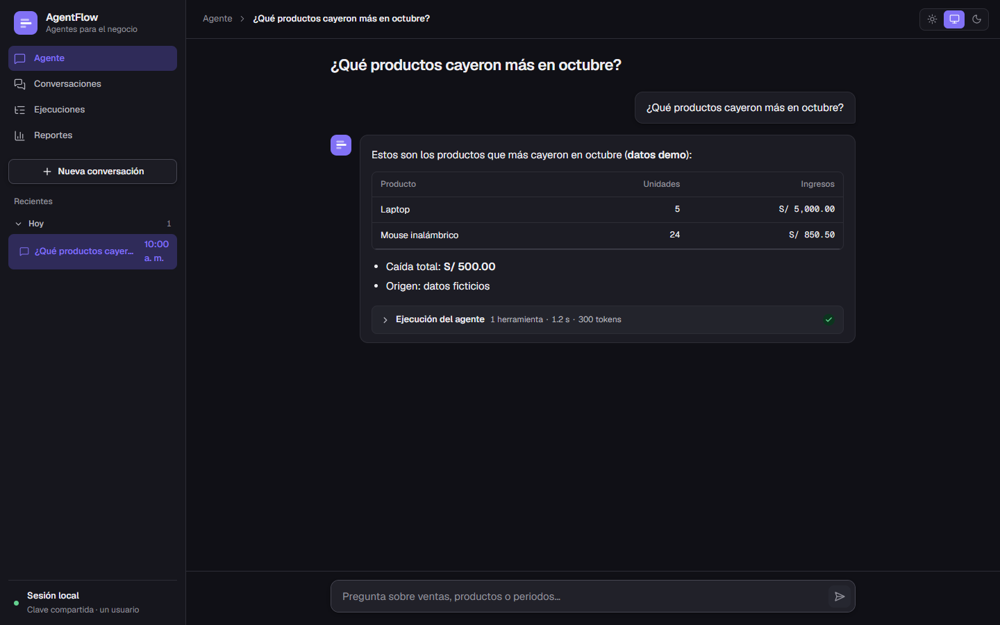
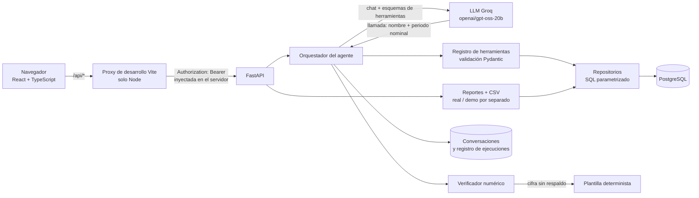
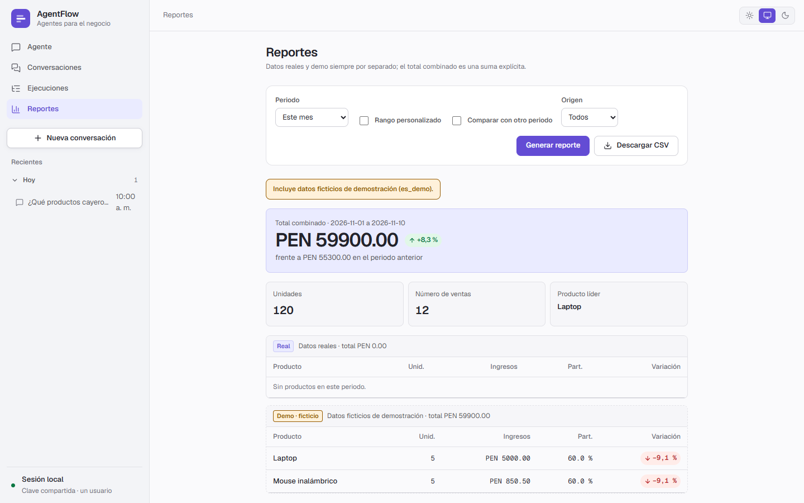
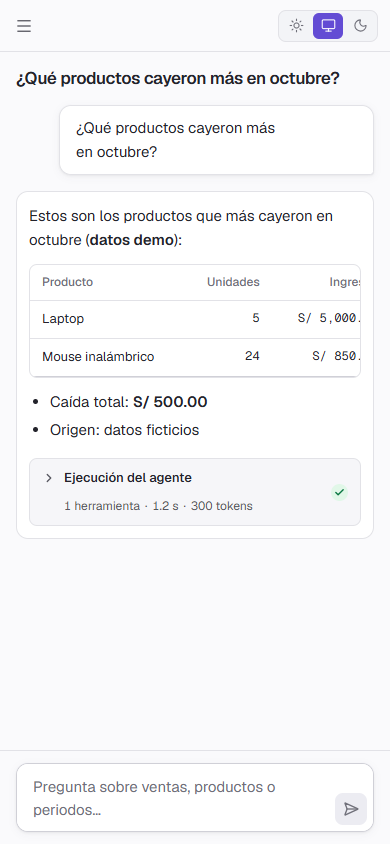

# AgentFlow

[English](README.md) · **Español**

Un agente de análisis comercial con herramientas para un negocio retail peruano ficticio. El usuario pregunta por sus ventas en español; un LLM elige entre un conjunto reducido de **herramientas validadas** que consultan PostgreSQL, y la aplicación —no el modelo— calcula cada cifra. Encima hay una interfaz en React y un backend en FastAPI.

> **Solo datos de demostración.** Todas las ventas de la base son ficticias (`ventas.es_demo = true`): 84 filas en la base local de la autora y 81 en una construcción desde cero. No hay ventas reales, y el agente y los reportes rotulan las cifras demo como tales.



*Las capturas de este README se tomaron con las respuestas de la API simuladas en el navegador (ver [Capturas](#capturas)).*

## El problema

Los LLM entienden bien una pregunta como «¿qué productos cayeron más en octubre?», pero calculan mal y se salen fácilmente de los datos. AgentFlow explora una respuesta pragmática: el modelo **elige una herramienta y un periodo con nombre**, el código determinista **consulta y calcula**, y un **verificador** rechaza cualquier respuesta con un número que las herramientas no devolvieron.

## Cómo funciona

- El modelo nunca escribe SQL ni calcula fechas. Elige una de cinco herramientas y un periodo (`este_mes`, `mes_anterior`, … o `AAAA-MM-DD/AAAA-MM-DD`). Pydantic valida los argumentos y los periodos se resuelven en código.
- Todo el SQL es parametrizado. Los ingresos son `cantidad * ventas.precio_unitario` (el precio vigente en cada venta).
- Cada número de la respuesta del modelo se contrasta con los resultados de las herramientas (`agentflow/agent/verifier.py`). Si una cifra no tiene respaldo, la respuesta se sustituye por una plantilla determinista construida con los datos de las herramientas.
- Cada resultado trae `origen_datos` (`demo`, `real`, `mixto`, `sin_ventas`), de modo que «no hay datos», «solo hay datos demo» y «nada que reportar» son situaciones distintas.
- Cada ejecución se registra (`ejecuciones`, `ejecucion_herramientas`): IDs, estado, tokens, duraciones, herramientas, argumentos y códigos de error; nunca el texto de la pregunta ni de la respuesta.

## Arquitectura



Estructura del repositorio:

| Ruta | Propósito |
|---|---|
| `agentflow/agent/` | Orquestador, conversación, verificador, plantilla de respaldo, prompts |
| `agentflow/tools/` | Resolución de periodos, esquemas, herramientas de ventas, reportes, registro |
| `agentflow/db/` | Conexiones (rol de permisos mínimos) y repositorios |
| `agentflow/llm/` | Interfaz del cliente LLM e implementación Groq |
| `agentflow/api/` | App FastAPI, autenticación, formato de error, límites, rutas |
| `frontend/` | Interfaz Vite + React + TypeScript (CSS propio, tokens de diseño) |
| `sql/migrations/` | Migraciones idempotentes (`000`–`006`) y reversiones en `down/` |
| `sql/setup/` | Creación del rol de la aplicación |
| `docs/` | `api-design.md`, `frontend-design.md` |
| `tests/` | `unit/`, `integration/` (requiere PostgreSQL), `evals/` |

Los archivos `agente.py`, `database.py`, `herramientas.py` y `test_*.py` de la raíz pertenecen al prototipo original y se conservan.

## Funcionalidades

- **Chat con el agente** sobre cinco herramientas: `ventas_totales`, `ventas_por_producto`, `comparar_periodos`, `productos_en_caida`, `reporte_ventas`.
- **Conversaciones**: crear, listar y reanudar (historial en PostgreSQL).
- **Ejecuciones**: estado, tokens, duración y herramientas usadas con sus argumentos, cargados bajo demanda.
- **Reportes**: ventas por periodo con comparación opcional, real y demo por separado con un total combinado explícito, y **exportación a CSV**.
- **Markdown seguro** en el chat (tablas, listas, negritas, código en línea); la salida del modelo nunca se interpreta como HTML y los enlaces no se renderizan como enlaces.
- Estados de carga, vacío y error en cada pantalla; temas claro, oscuro y del sistema; diseños revisados a 390, 900 y 1440 px.
- **API REST** con un único formato de error, CORS limitado a orígenes explícitos y límites en memoria (chat 10/min, 2 simultáneos, lecturas 120/min, 10 fallos de autenticación/min).

## Tecnologías

- **Backend:** Python ≥ 3.12, FastAPI, Uvicorn, Pydantic v2, psycopg 3, python-dotenv
- **LLM:** API de Groq, modelo `openai/gpt-oss-20b`
- **Base de datos:** PostgreSQL
- **Frontend:** React 19, TypeScript, Vite, Vitest, iconos Lucide, tipografía Geist
- **Pruebas:** pytest, httpx (pruebas de la API), Vitest

## Puesta en marcha

Los comandos son para Windows, donde se desarrolló el proyecto.

### 1. Base de datos

Requiere un servidor PostgreSQL local y una conexión de administrador. El esquema se construye desde cero:

```powershell
# como administrador (psql); primero crea el rol de la aplicación con permisos mínimos
psql -d agentflow_db -v contrasena="'elige-una-contraseña'" -f sql/setup/crear_rol_app.sql
# luego cada archivo en orden: 000 (tablas base + 3 productos ficticios), 001 … 006
psql -d agentflow_db -f sql/migrations/000_esquema_base.sql    # … repite de 001 a 006
```

Usa la contraseña elegida como `DB_PASSWORD` en `.env`. Las migraciones son idempotentes. Aplicadas a una base vacía producen 81 ventas ficticias (`es_demo = true`) y ninguna real. La aplicación se conecta con el rol separado `agentflow_app` (`SELECT` sobre ventas, `SELECT`/`INSERT` en historial y ejecuciones, más `UPDATE` limitado a las columnas de estado de `ejecuciones`; nunca DDL).

`scripts/verificar_migraciones.py` comprueba toda la cadena en una **base desechable** (aplica 000–006 dos veces, revisa columnas, datos demo y permisos del rol, y luego borra la base). Toma la conexión de administrador de las variables estándar `PGHOST`/`PGPORT`/`PGUSER`/`PGPASSWORD`.

### 2. Configuración

```powershell
copy .env.example .env   # completa tus propios valores; nunca subas .env
```

| Variable | Significado |
|---|---|
| `DB_HOST`, `DB_PORT`, `DB_NAME`, `DB_USER`, `DB_PASSWORD` | Conexión a PostgreSQL (usa el rol de permisos mínimos) |
| `GROQ_API_KEY` | Clave de Groq; solo se usa al conversar con el modelo real |
| `GEMINI_API_KEY` | Solo la usa `scripts/prueba_gemini.py`; el agente no la usa |
| `AGENTFLOW_API_KEY` | Clave compartida de la API, de al menos 32 caracteres; la generas tú |
| `AGENTFLOW_CORS_ORIGINS` | Orígenes permitidos, p. ej. `http://localhost:5173` |
| `AGENTFLOW_ENV` | `dev` habilita `/docs`; `prod` lo deshabilita |

### 3. Ejecutar backend y frontend (dos terminales, desde la raíz)

```powershell
# Dependencias de Python
python -m venv .venv
.venv\Scripts\python.exe -m pip install groq "psycopg[binary]" python-dotenv "pydantic>=2" fastapi uvicorn httpx pytest

# Terminal 1 — API
.venv\Scripts\python.exe -m uvicorn agentflow.api.app:crear_app_desde_entorno --factory --host 127.0.0.1

# Terminal 2 — interfaz
cd frontend
npm install
npm run dev        # http://127.0.0.1:5173
```

Conversar con el agente llama a la API de Groq y consume tu cuota. También hay un cliente de terminal: `.venv\Scripts\python.exe -m agentflow`.

## Pruebas

```powershell
.venv\Scripts\python.exe -m pytest                  # unitarias, sin red
.venv\Scripts\python.exe -m pytest -m integration   # requiere PostgreSQL local
cd frontend; npm test                               # Vitest (fetch simulado)
cd frontend; npm run typecheck; npm run build
```

En el último commit de código pasaron 254 pruebas unitarias, 19 de integración y 27 del frontend. Las pruebas unitarias y del frontend usan dobles y mocks; ninguna llama a Groq ni a Gemini. El arnés de evaluación de selección de herramientas está en `agentflow/evals.py` y `tests/evals/`.

## Seguridad

- `AGENTFLOW_API_KEY` nunca está en el código ni en el bundle de React (sin prefijo `VITE_`). El proxy de desarrollo de Vite (`frontend/vite.config.ts`, solo Node) la lee del `.env` raíz y añade la cabecera `Authorization` a las peticiones `/api/*`. Una prueba revisa que el código del frontend no contenga la clave ni `innerHTML`.
- La API autentica con una clave Bearer y falla cerrada si falta o es demasiado corta. CORS no se considera un mecanismo de protección del secreto.
- OpenAPI/Swagger solo se habilita con `AGENTFLOW_ENV=dev`.
- Los logs son JSON-lines sin claves ni texto de preguntas; los errores internos no llegan al usuario ni al modelo.
- El rol de base de datos de la aplicación no tiene DDL ni `UPDATE`/`DELETE` sobre las ventas.

## Limitaciones

- **Un solo usuario, clave compartida.** Sin cuentas ni propiedad de conversaciones: quien tiene la clave lo ve todo.
- **Solo proxy de desarrollo local.** La inyección de la clave ocurre en el servidor de desarrollo de Vite (`npm run dev`); un despliegue estático o `vite preview` no la inyecta. Una demo pública necesitaría un backend-for-frontend con login propio y cookie HttpOnly, que no está implementado.
- **Datos ficticios.** No hay ventas reales; los resultados describen un negocio ficticio.
- Las respuestas del chat son texto (Markdown); las cifras y tablas estructuradas están en la pantalla de Reportes.
- La API no vincula un mensaje con su ejecución, por lo que una conversación reanudada con turnos fallidos no muestra la traza por turno.
- Los límites de tasa están en memoria (un solo proceso).
- Las migraciones se verificaron desde cero solo en una instancia local de PostgreSQL 18. La base demo del autor incluye 3 ventas extra del prototipo (marcadas como demo por la migración 006) que una construcción nueva no tiene (84 frente a 81 filas).
- Aún no se ha añadido un archivo de licencia.

## Capturas

Tomadas con las respuestas de la API simuladas en el navegador (no es un backend real), por lo que las cifras son valores de ejemplo para revisar el diseño, no resultados de la base de datos.

| Reportes (claro, 1440 px) | Chat (claro, 390 px) |
|---|---|
|  |  |

## Más documentación

- [`docs/api-design.md`](docs/api-design.md) — diseño de la API
- [`docs/frontend-design.md`](docs/frontend-design.md) — diseño del frontend, integración y validación de la fase 4
