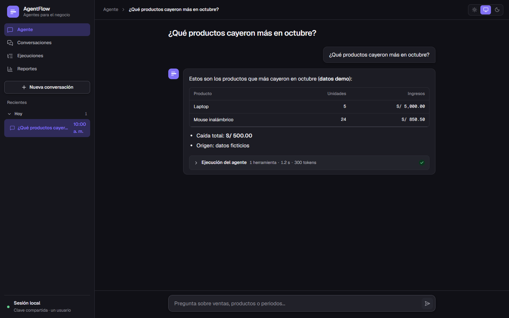
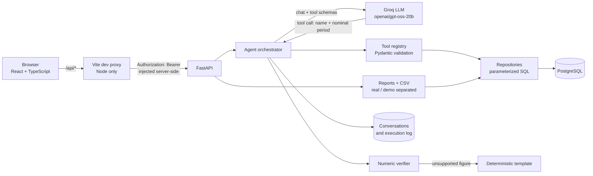
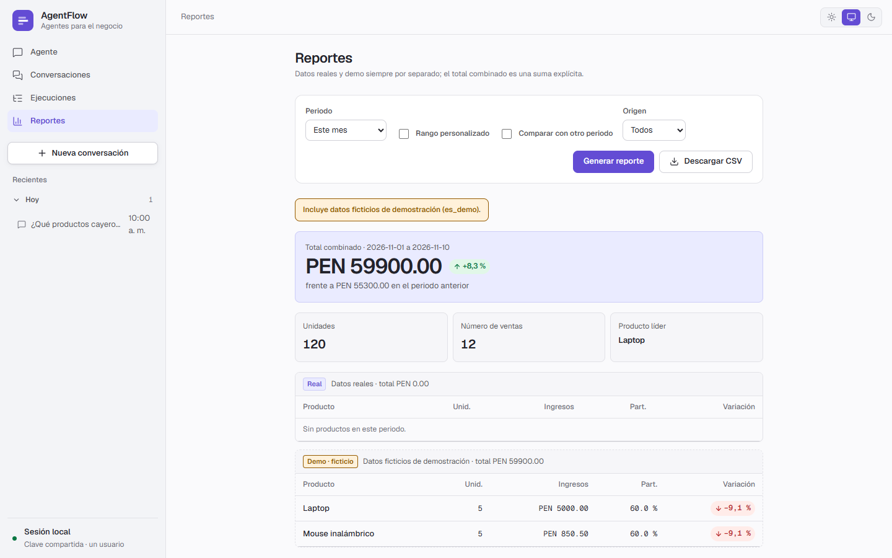
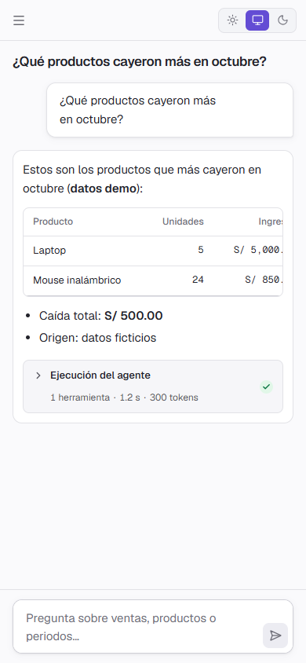

# AgentFlow

A tool-using commercial analytics agent for a fictional Peruvian retail business. Users ask sales questions in Spanish; an LLM chooses from a small set of **validated tools** that query PostgreSQL, and the application — not the model — computes every figure. A React interface and a FastAPI backend sit on top.

> **Demo data only.** All 84 sales in the database are fictional (`ventas.es_demo = true`). There are no real sales, and the agent and reports label demo figures as such.



*Screenshots in this README were captured with the API responses mocked in the browser (see [Screenshots](#screenshots)).*

## The problem

LLMs are good at understanding a question like "which products fell the most in October?" and bad at arithmetic and at staying inside the data. AgentFlow explores a pragmatic answer: let the model **select a tool and a named period**, let deterministic code **query and calculate**, and let a **verifier** reject any answer containing a number that the tools did not return.

## How it works

- The model never writes SQL and never computes dates. It picks one of five tools and a period (`este_mes`, `mes_anterior`, … or `YYYY-MM-DD/YYYY-MM-DD`). Arguments are validated with Pydantic; periods are resolved in code.
- All SQL is parameterized. Revenue is `cantidad * ventas.precio_unitario` (the price at the time of each sale).
- Every number in the model's answer is checked against the tool results (`agentflow/agent/verifier.py`). If a figure is unsupported, the response is replaced by a deterministic template built from the tool data.
- Each tool result carries `origen_datos` (`demo`, `real`, `mixto`, `sin_ventas`) so "no data", "only demo data" and "nothing to report" are distinct situations.
- Each run is recorded (`ejecuciones`, `ejecucion_herramientas`): IDs, status, token counts, durations, tool names, arguments and error codes — never the question or answer text.

## Architecture



Repository layout:

| Path | Purpose |
|---|---|
| `agentflow/agent/` | Orchestrator, conversation handling, verifier, fallback rendering, prompts |
| `agentflow/tools/` | Period resolution, tool schemas, sales tools, report builder, registry |
| `agentflow/db/` | Connections (least-privilege role) and repositories |
| `agentflow/llm/` | LLM client interface and Groq implementation |
| `agentflow/api/` | FastAPI app, auth, error format, rate limits, routes |
| `frontend/` | Vite + React + TypeScript interface (own CSS, design tokens) |
| `sql/migrations/` | Idempotent migrations and their `down/` reversals |
| `docs/` | `api-design.md`, `frontend-design.md` |
| `tests/` | `unit/`, `integration/` (needs PostgreSQL), `evals/` |

The files `agente.py`, `database.py`, `herramientas.py` and `test_*.py` in the root belong to the original prototype and are kept.

## Features

- **Agent chat** over five tools: `ventas_totales`, `ventas_por_producto`, `comparar_periodos`, `productos_en_caida`, `reporte_ventas`.
- **Conversations**: create, list and resume (history stored in PostgreSQL).
- **Executions**: per-run status, token counts, duration and the tools used with their arguments, loaded on demand.
- **Reports**: sales by period with optional comparison, real and demo shown separately with an explicit combined total, plus **CSV export**.
- **Safe Markdown rendering** in the chat (tables, lists, bold, inline code); model output is never interpreted as HTML and links are not rendered as links.
- Loading, empty and error states on every screen; light, dark and system themes; layouts checked at 390, 900 and 1440 px.
- **REST API** with a single error format, CORS restricted to explicit origins, and in-memory rate limits (chat 10/min, 2 concurrent, reads 120/min, 10 failed auth attempts/min).

## Tech stack

- **Backend:** Python ≥ 3.12, FastAPI, Uvicorn, Pydantic v2, psycopg 3, python-dotenv
- **LLM:** Groq API, model `openai/gpt-oss-20b`
- **Database:** PostgreSQL
- **Frontend:** React 19, TypeScript, Vite, Vitest, Lucide icons, Geist fonts
- **Tests:** pytest, httpx (API tests), Vitest

## Getting started

Windows commands are shown; the project was developed on Windows.

### 1. Database

You need a local PostgreSQL database with the `productos` and `ventas` tables from the original prototype. **Those two base tables are not created by this repository's migrations** (they only alter them and add the history/execution tables), so a fresh clone cannot build the schema from scratch yet.

Migrations in `sql/migrations/` are applied by an administrator with `psql`, in order (`001` → `006`). The application connects with a separate least-privilege role (`agentflow_app`: `SELECT` on sales data, `SELECT`/`INSERT` on history).

### 2. Configuration

```powershell
copy .env.example .env   # then fill in your own values; never commit .env
```

| Variable | Meaning |
|---|---|
| `DB_HOST`, `DB_PORT`, `DB_NAME`, `DB_USER`, `DB_PASSWORD` | PostgreSQL connection (use the least-privilege role) |
| `GROQ_API_KEY` | Groq key, used only when you chat with the real model |
| `GEMINI_API_KEY` | Only used by `scripts/prueba_gemini.py`; the agent does not use it |
| `AGENTFLOW_API_KEY` | Shared key for the API, at least 32 characters; you generate it |
| `AGENTFLOW_CORS_ORIGINS` | Allowed origins, e.g. `http://localhost:5173` |
| `AGENTFLOW_ENV` | `dev` enables `/docs`; `prod` disables it |

### 3. Run the backend and the frontend (two terminals, from the repo root)

```powershell
# Python dependencies
python -m venv .venv
.venv\Scripts\python.exe -m pip install groq "psycopg[binary]" python-dotenv "pydantic>=2" fastapi uvicorn httpx pytest

# Terminal 1 — API
.venv\Scripts\python.exe -m uvicorn agentflow.api.app:crear_app_desde_entorno --factory --host 127.0.0.1

# Terminal 2 — UI
cd frontend
npm install
npm run dev        # http://127.0.0.1:5173
```

Chatting with the agent calls the Groq API and consumes your quota. A terminal client is also available: `.venv\Scripts\python.exe -m agentflow`.

## Tests

```powershell
.venv\Scripts\python.exe -m pytest                  # unit tests, no network
.venv\Scripts\python.exe -m pytest -m integration   # needs local PostgreSQL
cd frontend; npm test                               # Vitest (fetch mocked)
cd frontend; npm run typecheck; npm run build
```

At the time of the last commit: 254 unit tests, 19 integration tests and 27 frontend tests passed. Unit and frontend tests use fakes and mocks; none of them call Groq or Gemini. The tool-selection evaluation harness lives in `agentflow/evals.py` and `tests/evals/`.

## Security

- `AGENTFLOW_API_KEY` is never in the React code or bundle (no `VITE_` prefix). The Vite dev proxy (`frontend/vite.config.ts`, Node only) reads it from the root `.env` and adds the `Authorization` header to `/api/*` requests. A test scans the frontend source for the key and for `innerHTML`.
- The API authenticates with a Bearer key and fails closed if the key is missing or too short. CORS is not treated as a secret-protection mechanism.
- OpenAPI/Swagger is enabled only when `AGENTFLOW_ENV=dev`.
- Logs are JSON lines without keys or question text; internal errors are not returned to the user or the model.
- The application database role has no DDL or `UPDATE`/`DELETE` rights on sales data.

## Limitations

- **Single user, shared key.** No accounts and no conversation ownership: anyone holding the key sees everything.
- **Local development proxy only.** The key injection happens in the Vite dev server (`npm run dev`); a static deployment or `vite preview` does not inject it. A public demo would need a backend-for-frontend with its own login and an HttpOnly cookie, which is not implemented.
- **Fictional data.** There are no real sales; results describe a fictional business.
- Chat answers are text (Markdown); the structured figures and tables are in the Reports screen.
- The API does not link a message to its execution, so a resumed conversation that contained failed turns shows no per-turn trace.
- Rate limits are in memory (single process).
- The database schema cannot be fully rebuilt from this repository (see [Database](#1-database)).
- No license file has been added yet.

## Screenshots

Captured with the API responses mocked in the browser (not a live backend), so the figures shown are sample values for layout checks, not results from the database.

| Reports (light, 1440 px) | Chat (light, 390 px) |
|---|---|
|  |  |

## More documentation

- [`docs/api-design.md`](docs/api-design.md) — API design
- [`docs/frontend-design.md`](docs/frontend-design.md) — frontend design, integration and phase-4 validation
